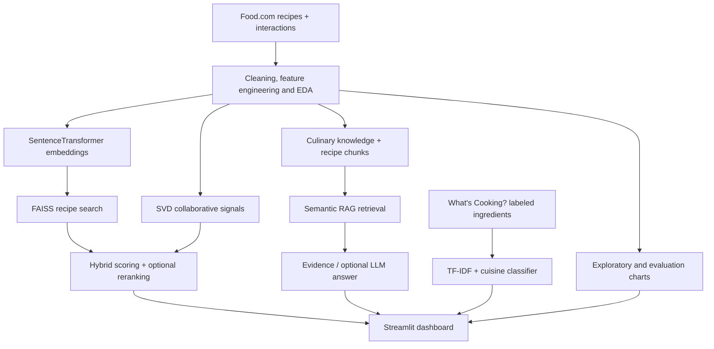

# 🥘 SousChef AI — Intelligent Recipe Discovery & Cooking Copilot

**SousChef AI** is an end-to-end data analytics and machine learning project that turns recipe data and user interactions into personalized food recommendations, cuisine predictions, and evidence-backed cooking assistance. It combines exploratory data analysis, natural language processing, semantic search, hybrid ranking, and a four-tab **Streamlit dashboard**.

> **Explore the dashboard:** a sample-data mode is available without model training. Research experiments and trained-model results are documented below.

## Features

| Dashboard | What it does |
| --- | --- |
| 🍳 **Recipe Discovery** | Search by ingredients or meal goals; filter by diet, cooking time, or excluded ingredients; inspect matching/missing ingredients and ranking signals. |
| 💬 **Ask SousChef** | Retrieve relevant recipe instructions and culinary guidance with visible sources. Optional LLM synthesis uses retrieved evidence. |
| 🌍 **Cuisine Predictor** | Classify ingredient lists into cuisines using an exported TF-IDF + Linear SVM or Logistic Regression model. |
| 📊 **Model Analytics** | Explore cooking-time distributions, frequent ingredients, review coverage, and model-evaluation metrics. |

### Analytics + ML workflow

- **Data preparation:** parse nested ingredient/step lists, normalize recipe text, validate preparation times, and join recipe ratings with interaction data.
- **Exploratory analysis:** study recipe duration, ingredient frequency, ratings versus review counts, and estimated dietary coverage.
- **Semantic retrieval:** encode recipe text with `sentence-transformers/all-MiniLM-L6-v2` and search with **FAISS**; optionally rerank with a cross-encoder.
- **Hybrid recommendations:** combine semantic relevance, pantry overlap, Bayesian-weighted ratings, preparation time, and **SVD-based collaborative filtering** when an existing user profile is available.
- **Retrieval-augmented cooking assistance:** search a knowledge base of culinary tips and recipe excerpts, return sources, and optionally generate a grounded answer with an LLM.
- **Supervised classification:** compare **TF-IDF + Logistic Regression** with **TF-IDF + Linear SVM** on cuisine labels.

## Results from the notebook

The provided Kaggle notebook was run with **20,000 Food.com recipes** and **500,000 interaction rows loaded**. The cuisine experiment used up to **30,000 labeled examples** from the *What's Cooking?* dataset with an **80/20 stratified train/test split**.

| Experiment | Result |
| --- | ---: |
| Cuisine — TF-IDF + Linear SVM accuracy | **77.63%** |
| Cuisine — TF-IDF + Linear SVM Macro-F1 | **69.56%** |
| Cuisine — TF-IDF + Logistic Regression accuracy | 74.67% |
| Cuisine — TF-IDF + Logistic Regression Macro-F1 | 67.24% |
| Recipe retrieval — HitRate@1 / @5 / @10 | 26% / 44% / 47% |
| Recipe retrieval — MRR | 0.334 |
| Culinary RAG retrieval — HitRate@5 / MRR | 100% / 0.833 |

**Evaluation scope:** recipe retrieval was tested on **100 sampled recipes**, querying with a subset of each recipe's ingredients to retrieve that same indexed recipe. It is an *in-catalog retrieval test*, not a measure of user satisfaction or recommendation accuracy on unseen recipes. The RAG figures come from **four hand-authored questions** with keyword/concept-based relevance checks; they are preliminary and do not establish answer faithfulness.

## Architecture



## Tech stack

**Python · pandas · NumPy · scikit-learn · Sentence Transformers · FAISS · SVD · NLP · Plotly · Streamlit · Jupyter/Kaggle**  
Optional: **OpenAI API** for generated RAG answers. No separate FastAPI server is needed.

## Run the dashboard locally

Clone/download this repository and open a terminal in the project directory (where `streamlit_app.py` lives):

```bash
python3 -m venv .venv
source .venv/bin/activate
python -m pip install -r requirements-demo.txt
python -m streamlit run streamlit_app.py
```

Open **http://localhost:8501**.

**Sample-data mode** uses 12 bundled recipes and TF-IDF search. It is ideal for exploring the interface, but **does not run the Kaggle-trained FAISS or cuisine models**.

### Model-backed inference

The repository includes a lightweight **12-recipe demo** for exploring the interface. Full recipe retrieval, personalized collaborative recommendations, and cuisine predictions require **locally available trained model artifacts** created by the accompanying notebooks. Demo outputs should not be interpreted as the reported trained-model results.

### Optional LLM responses

The chat works in **evidence-only mode** without an API key. For generated responses, switch to **OpenAI LLM + RAG** in the app and enter your key in the password field, or set `OPENAI_API_KEY` in your environment. API use may incur costs. Never commit credentials.

## Repository structure

```text
SousChefAI_Streamlit/
├── streamlit_app.py                     # Four-tab Streamlit user interface
├── souschef_core.py                     # Ranking, retrieval, and model inference
├── SousChefAI_v2_with_Streamlit_Export.ipynb
├── KAGGLE_EXPORT_CELL.py                # Exports trained notebook artifacts
├── requirements-demo.txt                # Lightweight demo dependencies
├── requirements.txt                     # Full model inference dependencies
├── data/
│   ├── sample_recipes.csv
│   └── culinary_knowledge.csv
├── artifacts/                            # Generated by Kaggle; not committed
└── README.md
```

## Data sources

- **Food.com Recipes and User Interactions**, Kaggle dataset by [Shuyang Li](https://www.kaggle.com/datasets/shuyangli94/food-com-recipes-and-user-interactions): recipes, ingredients, instructions, user ratings, and interactions.
- **Recipe Ingredients Dataset / What's Cooking?**, hosted by [Kaggle](https://www.kaggle.com/datasets/kaggle/recipe-ingredients-dataset), originally from Yummly: ingredient lists labeled by cuisine.

Datasets are **not bundled** in this repository. Refer to their source pages for licensing and usage conditions.

## Limitations and next steps

Diet and ingredient exclusions currently rely on keyword-based heuristics and **must not be treated as allergy-safe**. Collaborative recommendations need a user ID present in the training interactions. Model artifacts must be exported from Kaggle before full-model inference is available. Planned evaluation improvements include more labeled cooking Q&A, held-out recommendation tests, and user-centered relevance judgments.

**Safety:** This is a portfolio/educational project. Verify ingredients, allergens, cooking temperatures, and food-storage advice with reliable sources. Only load model files (`.joblib`) that you trust.
